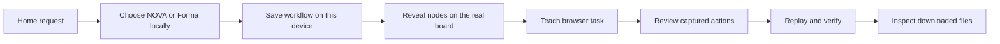

# Ghost: what I am building and fixing

Updated: October 17, 2026.

This explains the current work in plain language. It describes local changes in this workspace, not a new release or a claim that every workflow can run automatically.

## 1. The result we want

You type a normal request on Home, Ghost opens a workflow board, you teach its browser task, and Ghost can repeat that recorded task and show the downloaded results.

For the pitch, the NOVA and Forma workflow descriptions are prepared in advance. Their generation does not require Screenpipe, OpenAI, or the backend. Browser replay, however, performs real actions against the hosted website.

The whole graph is not yet an automatic end-to-end runner. Creating a node does not implement its action.

## 2. What happens when you submit a prompt

Examples:

- **NOVA:** “Check my sales and inventory in NOVA and prepare next week’s shopping list. Flag urgent products, estimate the cost, and prepare a Slack update for my approval.”
- **Forma:** “Review my payments and overdue invoices in Forma, prepare a finance report, and draft a Slack update for my approval.”

Ghost matches application names and task keywords. Longer keywords tolerate a one-character typo. If the request matches both scenarios, or neither, it asks you to choose NOVA or Forma. This is a local matching rule, not an AI interpretation of arbitrary requests.

The original request is retained in the workflow configuration. The resulting draft has five nodes:

| Node | What it represents | What actually runs today |
| --- | --- | --- |
| Screenpipe context | Find the routine in recorded history | Prepared context only; no history search during this flow |
| Browser task | Download the website reports | Real capture and replay after teaching |
| Report review | Inspect the exported results | NOVA calculates its reference Excel; a Ghost restocking calculation is not connected |
| Approval | Review the result before sharing | Draft review step; no connected approval-to-delivery runner |
| Slack update | Share a report summary | Message preview/instructions; no Slack message is sent |

No evidence IDs are invented. The prepared Screenpipe step is not evidence that Screenpipe searched your history.

## 3. Why it no longer needs the backend to generate

The first version skipped Screenpipe but still called the backend to create and open the workflow. That is why you could still get a backend error after clicking Generate.

The prepared flow now uses a local workflow client for creation, listing, loading, editing, searching, and deletion. Definitions are stored under `ghost.prepared-workflows.v1` in the renderer’s local storage.

This means:

- Backend downtime does not prevent the prepared board from opening.
- The board survives navigation and reload in the same app profile.
- These definitions are not synchronized to another device or the backend.
- Existing backend workflows have not been deleted. The live configuration continues to use the backend.
- Storage failures return an error instead of claiming a successful save.

`VITE_GHOST_DISCOVERY_MODE=live` selects the live path after restarting development or rebuilding. Prepared discovery is the current default; there is no mode switch on Home.

This only removes network dependencies from prepared workflow management. Browser tasks still need the website, and recording-secret backup may separately attempt its configured backend connection.

## 4. What the generation animation does

Generation now happens inside the actual workflow editor. There is no separate presentation canvas.

Each node reveals in this order:

1. A thinking state indicates the next step is being prepared.
2. The empty destination card appears.
3. The incoming arrow draws into that visible card (the first node has no incoming arrow).
4. The application image appears.
5. Text and details appear.

Each step takes roughly five seconds. The same node elements remain mounted afterward, keeping their positions and app images. You can then edit them. **Show all steps** skips the reveal; reduced-motion settings shorten it.

The animation presents a prepared workflow. It does not mean an AI call, website action, calculation, or Slack send happened during those seconds.

## 5. Hosted websites and teaching

The browser nodes use:

- NOVA: <https://hackathon-screenpipe.vercel.app/nova/restocking>
- Forma: <https://hackathon-screenpipe.vercel.app/finance>

Existing prepared NOVA nodes using the exact old `http://127.0.0.1:3104/nova/restocking` default migrate to the hosted URL. Custom URLs stay unchanged.

A recorded action log has its own URLs. Changing a node’s starting URL does not rewrite an old localhost recording; that task must be taught again on the hosted website.

Teaching means opening the site in Ghost’s Chromium browser and capturing the actual interactions. Replay resolves the target in the current page, executes supported actions, and checks the expected result. A download is verified through its completion, not just the export-button click.

### What I actually taught and verified

| Hosted task | Verified result |
| --- | --- |
| NOVA acceptance run | Two successful replays; sales CSV, inventory CSV, and Excel completed each time |
| NOVA changed stock | The checked Excel recommendation changed from 2 units to 0 |
| NOVA saved-node teaching | One additional successful replay; node reported Learned |
| Forma saved-node teaching | One successful replay; finance CSV completed; node reported Learned |

Both saved-node teaching runs are in the **separate profile** `/tmp/ghost-hosted-teaching-uD1DNV`. They were not installed into your currently open Ghost profile. I asked before restarting that app to avoid interrupting an unfinished recording.

For these tests, sign-in happened while capture was paused. The saved tasks therefore rely on that profile’s signed-in session; these runs do not prove automatic login replay. A temporary profile can also be removed by system cleanup.

See [Hosted teaching](HOSTED_TEACHING.md) for the teaching script and profile details.

## 6. The “Replay 2 actions / no replayable interactions” problem

I inspected the relevant recording files without printing field values or passwords.

The new session on `/nova/analytics` contained:

| Event | Count |
| --- | ---: |
| Page navigation | 2 |
| Page ready | 1 |
| Click/input/download | 0 |

The dialog counted navigation events as actions. The replay planner correctly found that there was no website interaction to repeat. This produced a confusing message: “Replay 2 actions” followed by “no replayable interactions.”

The previous recording still contained your interactions and downloads. The node’s saved-recording reference still pointed to that previous recording. **It had not been overwritten.** My initial suggestion that the empty recording replaced it was incorrect; checking the saved reference disproved that.

The immediate problem was that the dialog was inspecting the new empty session rather than the earlier saved recording. The files do not establish why you started that new session, and I am not claiming that clicks were dropped by the recorder.

### Fixes made

- Show website interactions separately from page navigations.
- Explain explicitly when only page loads were captured.
- Offer **Use saved recording** when a different saved recording exists for the same workflow node.
- Reopen that saved recording instead of repeatedly starting a fresh session.
- Say whether input fields exist, instead of always promising automatic passwords.
- Describe local input storage accurately instead of always saying “Server unavailable.”

The planner still blocks a recording with no interactions. Inventing clicks or pretending the workflow succeeded would not fix missing capture.

Restoring an older recording does not guarantee it is runnable: its actual actions still go through normal validation. Unsupported actions in that recording remain blockers.

## 7. Definitions, recordings, inputs, and results are different things

| Data | Where it belongs |
| --- | --- |
| Prepared workflow name, nodes, edges, positions | Local workflow storage in the app profile |
| Captured browser event log | Main-process recording directory |
| Saved recording for a node | Reference keyed by workflow ID and node ID |
| Recorded login secrets | Existing encrypted recording/input storage |
| Replay state and downloaded files | Local recording/run artifacts |

A board is the description of a task. A recording is the sequence that teaches Ghost how to perform its browser part. The replay result is evidence of what happened in one particular run.

Encryption does not create missing inputs. If the current recording captured no input fields, there are no recorded values to fill from that session. Existing encrypted inputs in an older saved recording are not automatically copied into a new empty session.

## 8. Main files involved

| File | Responsibility |
| --- | --- |
| `src/renderer/src/data/demoDiscovery.ts` | Prepared NOVA/Forma definitions, prompt matching, hosted starting URLs |
| `src/renderer/src/data/workflowClient.ts` | Local prepared CRUD; backend delegation for live configuration |
| `src/renderer/src/pages/Dashboard.tsx` | Home submission and navigation to the board |
| `src/renderer/src/pages/SavedWorkflowPage.tsx` | Load saved definitions into the editor |
| `src/renderer/src/pages/WorkflowEditor.tsx` | Real editor, save state, generation handoff |
| `src/renderer/src/components/WorkflowCanvas.tsx` | App images and staged reveal on real nodes/edges |
| `src/renderer/src/styles/workflow-generation.css` | Reveal and connection animation styles |
| `src/main/replayPlan.ts` | Planning, interaction/navigation counts, blockers |
| `src/main/teachingBrowser.ts` | Browser lifecycle, replay preview, saved-recording availability |
| `src/renderer/src/pages/RecordStep.tsx` | Teaching UI, accurate preview messages, saved-recording recovery |
| `src/shared/recording.ts` | Preview fields shared across main and renderer |
| `src/main/recordingStore.ts` | Existing event/input persistence and saved-node references; its empty-session preservation guard was already present |

## 9. Tests completed

- Root TypeScript checks and production build passed.
- Core regression suite passed, including separate navigation/interaction counts.
- Local workflow tests passed, including CRUD, storage failures, corrupt-data preservation, hosted-URL migration, and preserving custom URLs.
- Electron prepared-discovery tests passed with an unavailable backend: no backend/Screenpipe/AI calls; the real editor nodes remained mounted through generation and app logos survived reload.
- Hosted recording/replay checks passed as listed above.
- Electron empty-session recovery passed: zero interactions reported, earlier saved recording detected, original recording ID restored, and its replayable plan retained.

These are bounded tests on the controlled fixture websites, not proof of reliability on every website. The recovery test used the separate taught profile, not your currently open app session.

## 10. What still needs to happen

1. Restart Ghost to load the updated main-process and renderer code.
2. On the empty recording’s preview, select **Use saved recording** and review its actual plan.
3. Teach or install the desired hosted browser task in your normal profile; separate-profile tests do not populate it automatically.
4. Build the unified runner if we want one button to execute browser downloads, Ghost calculations, approval, and delivery as one workflow.
5. Connect a real Slack destination before claiming a message was sent.
6. Connect scheduling to fresh browser runs before claiming automatic Monday reports.

No commit or push was performed for this work.
