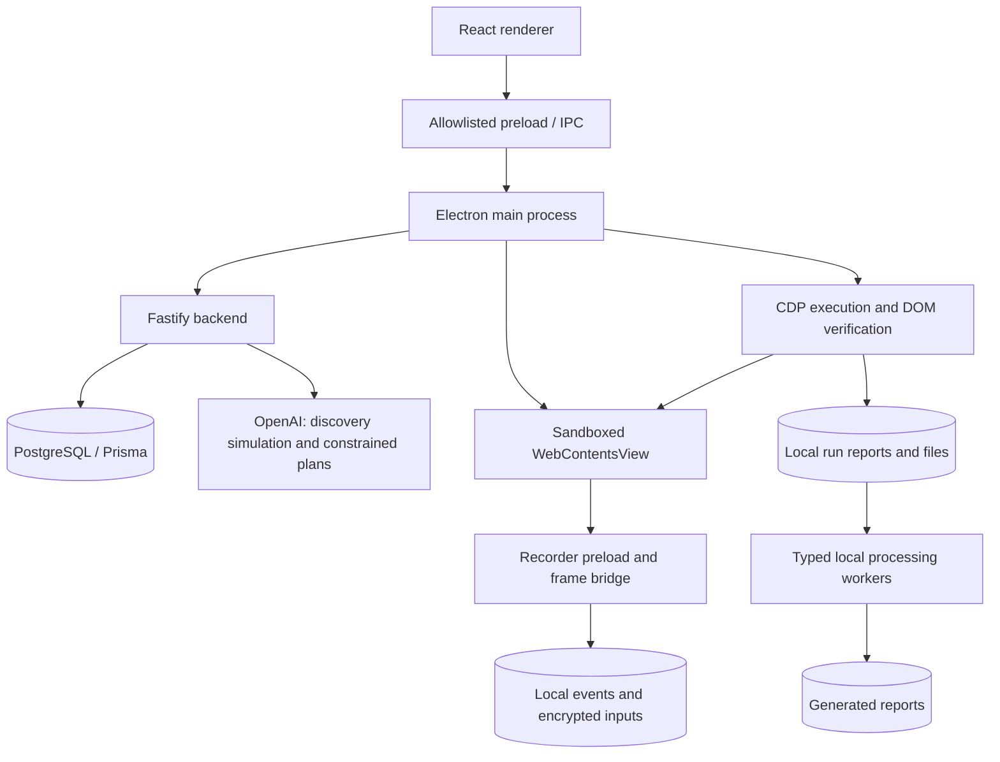

> Current discovery flow: Ghost invokes the dedicated Screenpipe Pipe and imports only its final JSON answer. Setup and live-service limitations are documented in [Screenpipe discovery](SCREENPIPE_DISCOVERY.md). Earlier retrieval-flow descriptions below are historical.

# Ghost — Technical implementation, current gaps, and delivery roadmap

Updated: **October 17, 2026**. Code baseline: **`23e182c`** plus the current Docker implementation changes. NOVA and onboarding were committed in that baseline; the Docker files are a subsequent change.

This document explains how the current implementation works and proposes the remaining work. Sections labeled **proposed** describe work that has not been implemented. A feature existing in code is distinct from having passed an end-to-end test against a particular website.

Start/run instructions: [Team onboarding](TEAM_ONBOARDING.md). Feature checklist: [Implemented features](IMPLEMENTED_FEATURES.md). Detailed recorder explanation: [Recording and replay](recording-and-replay-explained.md).

## Latest discovery update — October 17

Real Screenpipe retrieval/local AI is now wired to Home with separate prompts, evidence validation and backend graph persistence. See [Screenpipe discovery](SCREENPIPE_DISCOVERY.md). Earlier simulated-discovery descriptions below refer to the retained legacy endpoints. Live completion remains blocked by Screenpipe history-only mode and missing recent capture; integration adapters and unified execution are still separate roadmap work.

## 1. Current product boundary

Ghost currently combines four systems:

1. A native Electron workspace with Home, saved workflows, a graph editor, and recording pages.
2. A Fastify/PostgreSQL backend storing workflow definitions and encrypted input backups, with development AI generation endpoints.
3. A local Chromium recording/replay engine that executes supported website interactions and verifies observable results.
4. A local typed data-processing engine that consumes verified outputs and produces reports.

The desired complete product is a coordinated pipeline: discover real activity, generate a workflow, teach browser tasks, connect integrations, schedule execution, and inspect durable run results. Several pieces exist, but there is **not yet one complete runner that executes every node type across that pipeline**.

### Status overview

| Area | Current implementation | Main remaining gap |
| --- | --- | --- |
| Home and workflow editor | Backend-backed definitions, generation cards, editable nodes/positions | Remove remaining illustrative panels and clarify execution readiness |
| Discovery | Delayed mock stage plus OpenAI simulated workflow | Real activity retrieval and evidence validation |
| Browser automation | Recorded actions, semantic targeting, verified replay | Wider compatibility and fresh repeated acceptance tests |
| Inputs/login | Device-local encryption and encrypted backend backup | OS-backed key protection and deliberate cross-device recovery |
| Files/results | Local downloads, summaries, previews and processing artifacts | Durable server-side run/artifact indexing |
| Processing | Manual operations and constrained generated plans | Unified orchestration with browser and integration nodes |
| Scheduling | Local processing schedules using existing browser outputs | Fresh browser execution and integration delivery on each run |
| Integrations | Node descriptions/contracts and configuration boundaries | Actual Slack/email/application adapters |
| Practice websites | Forma and NOVA | Complete NOVA responsive and recorder acceptance reruns |
| Deployment | Root Compose and Dockerfiles for database/API/renderer preview/fixtures | Container runtime validation, web management adapter and desktop packaging |

## 2. Architecture and trust boundaries



The renderer presents UI and requests actions. Privileged filesystem access, decryption, native-view management and browser execution stay in Electron's main process. Remote websites do not receive the application's privileged bridge. Shared types define the messages and data exchanged between these components.

The backend controls workflow persistence and server-side AI credentials. It does not currently run the user's desktop browser. The PostgreSQL run models are a foundation; local browser reports are not automatically equivalent to fully synchronized backend run history.

## 3. UI and workflow management

**Code:** `src/renderer/src/pages/`, `components/`, `styles/`, `src/main/discoveryBackend.ts`, `backend/src/modules/workflows/`.

Implemented changes include the redesigned Home screen, simplified request field, removal of the old How it works panel and attachment picker, application imagery, saved workflow cards, loading/empty/error states and a generating card. The workflow list and editor are separate routes. The editor retains the navigation sidebar, supports pan/zoom/node movement, and uses centered node dialogs.

Workflow names, descriptions, status, node configurations, edges and positions persist through the backend. The API validates graphs and performs graph replacement transactionally. Edge endpoints must belong to the same workflow. Graphs with execution history cannot simply be replaced without the existing versioning restriction being addressed.

Browser nodes describe one complete browser task with a starting URL and instructions. The human teaches the interaction sequence separately. An application icon or a generated node does not establish that its integration is implemented.

**Important UI distinction:** the board's Test run currently previews/validates steps. Real browser actions run through Test recording. Processing runs consume saved browser outputs. A future unified Run button must not conceal these differences.

## 4. Discovery: request to saved workflow

**Code:** `backend/src/modules/discovery/`, `src/shared/discovery.ts`, desktop discovery bridge and Home page.

Current lifecycle:

1. Home retains the original user request and selected time range.
2. The mock endpoint waits approximately five seconds and returns a development simulation acknowledgement.
3. The generation endpoint asks OpenAI to mimic a high-level Screenpipe discovery response.
4. Structured output is validated before creating nodes and edges.
5. The backend saves the draft graph in PostgreSQL and returns the workflow.
6. Home replaces its generating card with the saved workflow and Open board action.

The system instructions request what happened, applications, ordering, available URLs, evidence and missing information. They do not generate selectors, coordinates or executable browser instructions. Development simulation is explicitly labeled, and mock/generation endpoints reject production mode. A retained request UUID helps reuse an already saved result and reject concurrent duplicate generation on one server.

**Not implemented:** reading actual Screenpipe activity, resolving real evidence IDs, detecting repeated workflows from real history, or validating the simulated steps against observed user actions.

## 5. Browser lifecycle and manual interaction

**Code:** `src/main/teachingBrowser.ts`, `frameBridge.ts`, `src/preload/index.ts`, `src/renderer/src/pages/RecordStep.tsx`.

A teaching session creates or restores a recording and opens a persistent-session WebContentsView. The view owns the website, address navigation, back/forward/reload behavior and loading state. The page reports layout bounds to the main process. Diagnostics expose capture readiness, focus, visibility, bounds and received-event counts without requiring field-value logs.

Native view layering caused the website to cover renderer dialogs. The implementation uses main-process modal holds and detaches/hides the native view before displaying the dialog. Bounds updates cannot bring it back while held. Closing the dialog restores the existing page rather than reloading the site.

The browser session preserves permitted login cookies. URL validation rejects non-web or credential-bearing addresses. OAuth/provider restrictions remain website constraints; Ghost does not bypass them or silently transfer credentials to another browser.

## 6. Capture, target identity, and event planning

**Code:** `src/preload/recorder.ts`, `src/shared/recording.ts`, `src/shared/pageOperation.ts`, `src/main/replayPlan.ts`, `replaySettings.ts`, `prepareReplay.ts`.

Capture records supported navigation, clicks, input changes, checkboxes/radios, native selections, keyboard actions, scrolls and related outcome evidence. Frame-aware capture uses supported frame identities and geometry; arbitrary frame structures are not guaranteed.

Targets include stable IDs/test IDs, roles/names, labels, placeholders, relevant text, context and CSS fallback information. The replay resolver inspects the live DOM, ranks these strategies, checks uniqueness and availability, and stops on ambiguity. Recorded pointer positions support diagnostics and narrowly constrained background hit testing, not arbitrary fallback clicking.

Planning consolidates repeated changes, supported native-select interactions and causal submission events. Stop-time flushing preserves pending input/scroll information. Unsupported meaningful actions remain visible as blockers rather than disappearing.

### Confirmed planning bug and its fix

The old double-build path could validate events, discard unsupported events when producing executable steps, and then rebuild a plan that had lost the original blockers.

The actual shared planning path now applies saved overrides to the **complete event log**, then builds the plan once:

```ts
return buildReplayPlan(applyInputs(events, inputs))
```

This preserves unsupported events during validation and keeps raw sequence IDs available for older input overrides. Main-process callers and regression tests use the same `prepareReplay` path.

## 7. Replay executor, evidence and recovery

**Code:** `src/main/replayRecording.ts`, `replayDiagnostics.ts`, shared page operations and local recording persistence.

For supported actions, execution follows these stages:

1. Check cancellation, page identity, browser readiness and target preconditions.
2. Resolve a unique live target with a suitable verification strategy.
3. Persist dispatch intent before sending an event that could change the page.
4. Execute using Chromium-native/CDP input where appropriate.
5. Wait within bounded time for the expected observable result.
6. Store the action outcome and last verified checkpoint.

Text insertion is verified against the resulting value/editor state. Selections and checkbox/radio changes verify selected/checked state. Navigation checks destination evidence. Keyboard focus transitions use recorded destination evidence where available. Modal/status/ARIA changes and downloads have their own supported evidence paths.

A dispatched click is not automatically successful. A verified UI transition also does not prove an external business operation succeeded beyond the evidence captured.

Recovery first observes the current state: did the result already happen, is the target transiently unavailable, or is the page different? Polling can recover from slow rendering. Arbitrary clicks/submissions are not repeatedly dispatched after an uncertain result. Scroll has a bounded retry path.

| Failure category | Meaning / response |
| --- | --- |
| `TARGET_NOT_FOUND` | No matching available target before timeout; inspect page and initial state |
| `TARGET_AMBIGUOUS` | Multiple plausible targets; improve identity/context rather than guess |
| `ACTION_UNSUPPORTED` | Action lacks supported execution/verification; re-teach or implement support |
| `EXECUTION_FAILED` | Action could not execute; examine dispatch diagnostics |
| `VERIFICATION_TIMEOUT` | Expected evidence did not appear within the bound |
| `OUTCOME_UNKNOWN` | An action may have occurred; inspect before attempting anything again |
| `RESUME_REJECTED` | Saved checkpoint no longer matches the current plan/document |
| `CANCELLED` | Further dispatch stopped; prior in-flight effects may still need inspection |

The replay journal includes workflow/recording identity, plan hash, current action index, last verified checkpoint and diagnostic evidence. Ordered atomic writes reduce corruption risk. Resume revalidates the same plan, URL and document. It does not provide automatic cross-restart or post-reload continuation. Starting a saved recording again from its beginning is a separate supported operation.

Fast and slow demo modes share execution/verification. Slow mode adds pauses and non-intercepting target highlights, rechecks the target after the pause, and remains cancellable.

## 8. Credentials, persistence and portability

**Code:** `src/main/recordingStore.ts`, `recordingSecrets.ts`, `recordingSecretsBackend.ts`, `loginVault.ts`, backend recording-secret routes.

Stopping a meaningful recording associates it with its workflow/node. Reopening restores the same recording and starting URL. Empty new sessions do not silently replace saved node references. Edited input overrides persist and are used during planning/replay.

Current secret protection uses AES-256-GCM with a random 32-byte device key, a fresh 12-byte IV, authentication tag and contextual authenticated data. The key file is created with restricted permissions. It is **not yet an OS keychain/vault**. Values are decrypted locally for replay; masked displays and encrypted backups avoid treating passwords as ordinary plaintext fields.

Backend backups contain encrypted bundles. Recording-specific access tokens are derived locally; the backend stores token hashes. Remote sync requires HTTPS, with loopback HTTP allowed for development. The device key is not uploaded. Backend backup therefore does not make another teammate's machine capable of decrypting the recording.

Limitations include lost local keys, expired passcodes, changed credentials and website-specific authentication. Do not confuse encrypted local storage with full enterprise credential management, tenant authorization or portable secrets recovery.

## 9. Downloads, results and data processing

**Code:** recording/replay modules, `ReplaySummary.tsx`, `src/main/dataProcessing/`, `backend/src/contracts/`.

Downloads are registered against the run and saved locally. Verification checks completion and file metadata, including byte count. Per-run results preserve action outcomes and artifacts. Supported small CSV/text/JSON/log files have inline previews; reveal/open-folder actions are constrained to registered artifacts. Files are not installed or executed automatically.

Browser outputs can include downloads and configured text, JSON or table extraction. Extraction validates shape and limits. Processing resolves verified upstream outputs and uses typed values: files, rows, text, JSON, numbers and booleans.

Manual operations include reading/merging files, filtering rows, mapping columns, comparing datasets, finding duplicates/missing records, aggregation, conditional logic and report generation. CSV/XLSX/JSON processing is local. Graph/type validation, artifact registration, content checks and limits constrain execution.

Generated processing logic is a separate AI feature: inspect actual inputs, review schema/sample sharing, consent to generation, validate a constrained plan, test against real data, then approve. Plans use supported operations rather than arbitrary generated JavaScript. Changed inputs, file content, objectives or bindings can invalidate approval context.

## 10. Scheduling and the missing unified runner

**Code:** `src/main/workflowScheduler.ts` and its execution callback in `src/main/index.ts`.

Schedules persist locally with a future start, interval, last-run time and result. Intervals support one-time/hourly/daily/weekly use. A per-workflow busy guard prevents overlapping local executions. A due schedule runs once on wake rather than replaying every missed interval; its next interval is computed from the current tick time. This is interval scheduling, not a complete timezone-aware calendar scheduler.

The callback currently runs supported local processing against existing verified browser outputs. It rejects unsupported graph node types. It does not automatically replay browser nodes to refresh downloaded data. Ghost must stay open.

**Example limitation:** a daily report schedule may process yesterday's saved CSV if no new browser run produced a fresh input. A full daily business workflow needs a runner that first executes browser extraction, checks freshness, processes that run's outputs, then calls the approved delivery integration.

## 11. Backend implementation

Fastify supplies HTTP routes, logging, CORS, centralized errors and health checks. Zod validates input/environment configuration. Prisma uses the PostgreSQL adapter with generated client code, migrations and reusable database access.

Models include User, Workflow, WorkflowNode, WorkflowEdge, WorkflowRun, NodeRun and RecordingSecret. UUIDs, timestamps, enums, indexes and relational constraints maintain graph/run integrity. General user authentication and tenant isolation are not implemented; owner metadata is not authenticated identity.

| Routes | Responsibility |
| --- | --- |
| `GET /health` | API/database readiness |
| `GET/POST /api/workflows` | List/create saved definitions |
| `GET/PATCH/DELETE /api/workflows/:id` | Retrieve, edit and delete |
| `POST /api/workflows/:id/contracts` | Generate/save scoped node contracts |
| `POST /api/workflow-discovery/prepare`, `/mock`, `/generate` | Preparation and development discovery |
| `POST /api/workflows/nodes/generate-logic`, `/approve-logic` | Constrained processing-plan endpoints |
| `GET/POST/DELETE /api/recording-secrets` | Capability-scoped encrypted backups |
| `/docs/`, `/docs/json` | Swagger UI and OpenAPI definition |

Backend environment variables are documented in `backend/.env.example`. OpenAI credentials remain server-side. There is no general run-upload/worker-claim API merely because run tables exist.

## 12. Practice websites and test evidence

Forma (`tests/`) provides login, finance and customer dashboards with native labeled controls, filtering, edits and CSV export. NOVA adds a store dashboard, orders, inventory, customers, campaigns, discounts and settings with separate localStorage/session state. Both are local fixtures, not real account/payment systems.

NOVA artwork is bundled under `tests/public/nova/`, with generation details in `ASSETS.md`. Its pages use stable identities and visible mutation feedback. The map/sparklines and some seeded totals are illustrative and labeled accordingly.

### What has actually been verified

- The Next.js production build, including TypeScript compilation, passed before commit `23e182c` was pushed.
- Historical reports include 20 runs each on three controlled browser fixtures and 20 each on Forma finance/users: 100 successful runs in that recorded campaign.
- Separate historical suites cover negative cases, recovery, saved credentials, downloads, demo highlights, processing and native-view dialogs.
- NOVA's interaction script exercised login, exports and edits, then found mobile overflow. A CSS fix was added, but the final responsive rerun and full Ghost/NOVA recording acceptance remain pending.
- This document update does not constitute a new execution of those runtime tests.

Use the scripts and dated JSON reports under `scripts/`, `tests/scripts/` and `docs/` to distinguish current code coverage from actual run evidence. The mere presence of a script is not a passing test.

## 13. Docker status — what happened and what remains

**Implemented now:** root `compose.yaml`, Dockerfiles for backend/migration, renderer preview and standalone Next.js fixtures, Nginx API proxy, environment example, health checks, named database volume and smoke script. PostgreSQL-only `backend/compose.yaml` is retained for the older manual setup. See [Docker setup](DOCKER.md).

**Verification:** local application builds and Compose YAML checks passed. Docker is unavailable on this machine; image builds, container startup, migration ordering and container smoke tests remain unverified. The first Docker attempt was interrupted before edits; the subsequent implementation added these files.

The frontend is an Electron renderer that calls `window.ghost`, exposed through preload IPC. Serving its HTML in a container does not supply that bridge. Current browser preview does not become a functional web client simply because the backend is reachable.

### Deployment follow-up (initial files implemented; runtime validation pending)

1. Implemented in `backend/Dockerfile`: backend build/runtime stages with Node 24, required Prisma/OpenSSL dependencies and generated compiled client output.
2. Implemented in root Compose: a one-shot migration service that waits for healthy PostgreSQL. Start the API only after migrations succeed.
3. Implemented in `tests/Dockerfile`: containerized Next.js fixtures, binding inside the container to `0.0.0.0` and exposing host port 3100.
4. Implemented: an explicitly labeled renderer-preview container for design review.
5. If full browser-based workflow management is required, implement a real HTTP API client abstraction for discovery/CRUD, with separate Electron IPC and web adapters. Disable native-only actions with clear UI explanations; do not fabricate `window.ghost` capabilities.
6. Keep Electron on the user's host for native browser recording/replay, credentials and local artifacts. Connect it to the containerized backend through the published port.
7. Document environment/secrets, health checks, named volumes, port conflicts, migrations and restore behavior. Exclude `.env`, profiles, recordings and host dependencies from build contexts.
8. Verify a clean build/start, database persistence, migration failure handling, API health and host-Electron connectivity on a machine with Docker.

A GUI Electron container would require separate display/audio/device integration and testing. It is not equivalent to an ordinary web frontend container and is not part of the existing implementation.

## 14. Remaining implementation work, in priority order

### P0 — Reproducible hackathon demo

**Work:** finish Docker support for the server-side stack; correct stale preview labels/docs; finish NOVA responsive/replay checks; rehearse a saved browser task and a processing report on the presenter machine.

**Acceptance:** a new teammate can start services from documented commands, generate or open a workflow, record login/filter/export, run slow replay, inspect the CSV and reproduce a processing result. Clearly mark simulated discovery and unimplemented integrations.

### P1 — Unified graph execution

**Proposed code:** a coordinator module in Electron, shared run contracts, browser/processing/integration executor adapters, backend run endpoints and workflow revision storage.

**Work:** freeze a workflow revision, validate all node types/bindings up front, execute dependencies in order, attach outputs to a unique run ID, support cancellation/intervention, and publish durable node/run states. Ensure consumers cannot accidentally read outputs from an earlier run unless explicitly permitted.

**Acceptance:** browser export → processing → human review completes under one run ID. A failed or uncertain browser action prevents downstream delivery. Edited definitions do not mutate an active run. Restart does not silently repeat a send/payment.

### P1 — Run and artifact persistence

**Work:** add authenticated run creation/update/read APIs, idempotent event ingestion, artifact metadata/checksums, redaction and retention rules. Decide whether files remain local with references or are explicitly uploaded. Add backend-backed run history to the UI.

**Acceptance:** reconnecting syncs a local result once; a teammate can distinguish successful, failed and unknown outcomes. Download links never pretend a file exists on a different machine.

### P1 — Real integration adapters

**Work:** implement one narrow delivery adapter first, such as a chosen Slack channel or an approved email destination. Define typed inputs/outputs, connection credentials, permission scope, provider errors, rate limits and idempotency/reconciliation behavior.

**Acceptance:** deliver one verified report, retain provider evidence, and avoid duplication after a timeout/restart. Require explicit approval or a narrowly scoped preconfigured authorization. Mark missing connections as not runnable.

Screenpipe may supply discovery context or connected capabilities where actually supported. Do not assume that observing Slack/email makes those actions executable.

### P2 — Fresh scheduled workflows

**Work:** invoke the unified runner from schedules, identify the designated executing device, check browser/auth readiness, acquire an execution lease, enforce output freshness and define timezone/DST/missed-run behavior.

**Acceptance:** a daily run captures fresh dashboard data before processing. An offline device produces a visible missed/deferred state, not success. Two devices cannot execute the same consequential scheduled run simultaneously.

### P2 — Real Screenpipe discovery

**Work:** retrieve scoped actual activity after user authorization, normalize observed records, attach real evidence IDs, validate model references and URLs against records, and expose inferred/missing steps for confirmation. Keep the simulation mode separate.

**Acceptance:** every claimed observed step links to supplied evidence; missing URLs stay null; inaccessible Screenpipe yields an actionable connection error. The AI still does not invent browser actions/selectors.

### P2 — Recording compatibility and replay reliability

**Work:** rerun the full suite on the current revision, add failing real-world reproductions, extend outcome evidence/locators only for demonstrated cases, and expand frame/editor support with regression tests. Improve intervention UI for ambiguous and unknown results.

**Acceptance:** at least 20 successful varied-state runs per supported fixture on the release candidate, plus expected safe stops for ambiguity, unsupported actions and uncertain submissions. Report success counts and failures separately.

### P2 — Accounts and device security

**Work:** implement user authentication, workflow authorization, tenant isolation and device registration before exposing shared APIs broadly. Move local key protection to an OS-backed store, define rotation/revocation and optional recovery, and audit logs/exports for secret leakage.

**Acceptance:** users cannot retrieve another tenant's workflows/artifacts; revoked devices lose access; encrypted backup recovery has a tested documented policy rather than an assumed shared key.

### P3 — Packaging, operations and lifecycle

**Work:** desktop installers and update strategy, CI build/test separation, supported-platform matrix, schema/recording migration tests, backup/restore tools, artifact retention and storage usage controls.

**Acceptance:** clean install/update preserves recordings and keys; old recordings migrate without silent loss; storage cleanup is scoped and previewable; fresh environments run the documented smoke suite.

## 15. Decisions the team should settle before implementing the roadmap

| Decision | Suggested initial choice |
| --- | --- |
| Where does browser execution run? | One registered local desktop device per workflow |
| Is a web-only app required? | Web management/preview later; retain Electron for teaching/replay |
| First real integration? | One report-delivery use case with a fixed demo destination |
| What counts as success? | Per-node observable evidence plus explicit business confirmation where needed |
| What does a schedule execute? | A versioned graph using fresh outputs from that run |
| Should credentials travel between machines? | Keep device-local initially; design recovery separately |
| Where do reports live? | Local artifacts first, with backend metadata and explicit upload policy |
| What must work for the demo? | One rehearsed browser task, verified CSV and one processing report |

## 16. Verification and handoff checklist

Before calling the next milestone complete:

- Run root/backend/fixture typechecks and builds.
- Run unit and database integration suites with their required environments.
- Run Electron replay/recovery tests sequentially on a supported graphical session.
- Complete NOVA responsive and full recording tests; preserve output and failure categories.
- Verify saved credentials and recordings across a real app restart.
- Verify failed/unknown actions do not dispatch downstream mutations.
- Test new Docker images and Compose on a clean machine; do not report configuration inspection as runtime success.
- Update dated evidence and the teammate guide, including limitations.

This document is a technical handoff and implementation plan. Docker configuration now exists in the accompanying code; integrations, authentication and unified execution remain proposed.
