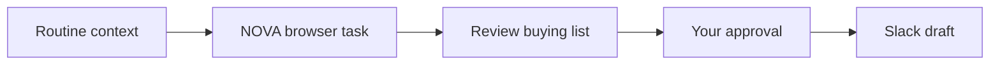

# NOVA — Sales, inventory, and next week’s shopping list

Updated: October 17, 2026.

## Goal

Review how quickly products sell, compare demand with stock and incoming deliveries, and prepare an explained buying list for approval.

The intended recurring request is:

> Check my sales and inventory in NOVA every Monday and prepare next week’s shopping list. Flag urgent products, estimate the cost, and prepare a Slack update for my approval.

For the current pitch, Ghost creates a prepared workflow locally. Its browser task performs real website interactions after teaching. Automatic Monday execution and Slack delivery are not connected yet.

## The five workflow nodes

| Order | Node | Purpose | Current implementation |
| --- | --- | --- | --- |
| 1 | Screenpipe context | Identify the recorded sales/restocking routine | Prepared context; no Screenpipe history request in this flow |
| 2 | NOVA browser task | Download sales, inventory, and the reference shopping list | Real browser recording and verified replay |
| 3 | Review restocking calculations | Inspect quantities, costs, assumptions, and warnings | NOVA calculates the reference Excel; Ghost-side restocking arithmetic is not connected |
| 4 | Your approval | Decide what to buy and whether to share the report | Draft human-review step; not an automated approval service |
| 5 | Slack update | Share the recommendation with the team | Draft/preview instructions; no real message is sent |

All browser interactions belong to **one browser node**. We do not need a separate workflow node for each click or download.



## What happens when you submit the prompt

1. Ghost recognizes the NOVA/restocking request using local keywords and typo-tolerant matching.
2. It saves the prepared definition on this device.
3. The actual board opens and shows a thinking state, reveals the next empty card, draws its incoming arrow, then adds the app image and text.
4. Those same nodes remain on the board for editing.
5. You teach the browser node, or open its existing saved recording.

Creating the board does not execute the five-node business process. The generation animation does not represent an AI request or website execution.

## Hosted website

Use [NOVA Restocking](https://hackathon-screenpipe.vercel.app/nova/restocking).

If authentication is required, use [NOVA Login](https://hackathon-screenpipe.vercel.app/nova/login). The fixture displays its public demo account:

- Email: `alex@nova.test`
- Password: `nova-demo`

These are credentials for the controlled demo fixture, not a real merchant account.

The existing prepared NOVA URL is migrated from the old port-3104 default to the hosted URL. Custom URLs are preserved. Old recorded actions retain their original URLs, so a localhost recording must be taught again on the hosted site.

## Browser preparation — before recording

1. Open NOVA inside Ghost’s embedded browser.
2. Sign in if needed.
3. Open the Restocking page.
4. For the five-product presentation, use **Load five-product demo stock** before starting the task recording.
5. Review and save the desired planning settings:
   - Sales period.
   - Planning date.
   - Review period and safety days.
   - Available stock for each product.
   - Supplier, unit cost, and delivery lead time.
   - Incoming quantity and expected arrival date.
   - Budget.

Do not include loading/resetting demo stock in the recorded task. Otherwise replay could reset the inventory you changed to demonstrate an updated recommendation.

For the verified teaching runs, login was performed with capture paused. The saved export task assumes the browser session is already signed in. Those tests do not establish automatic login replay.

## What we record inside the browser

Start a clean recording once you are signed in and the desired data is ready.

| Step | Browser action | What we check |
| --- | --- | --- |
| 1 | Open or start on `/nova/restocking` | The intended page and export controls are available |
| 2 | Click **Download sales CSV** | `nova-restock-sales.csv` completes |
| 3 | Click **Download inventory CSV** | `nova-restock-inventory.csv` completes |
| 4 | Download the shopping-list Excel | `nova-shopping-list.xlsx` completes |
| 5 | Wait for all downloads, then stop capture | Files and captured actions are saved |

This taught task exports the current saved state. Reviewing or editing settings before capture is preparation, not an additional recorded calculation step.

The three files have different roles:

| File | Contents |
| --- | --- |
| `nova-restock-sales.csv` | Order ID, product ID, date, quantity, status, and selected sales window |
| `nova-restock-inventory.csv` | Stock, supplier, cost, lead time, incoming deliveries, and planning settings |
| `nova-shopping-list.xlsx` | Recommended purchases, costs, urgency, warnings, explanations, and assumptions |

Product IDs connect sales rows to inventory rows. The calculation uses qualifying sales statuses; a sales CSV row is not automatically counted merely because it appears in the export.

## How the restocking calculation works

The current implementation is in `tests/lib/restocking.ts` and runs in NOVA.

### 1. Count qualifying sales

Include quantities from **Paid** and **Shipped** orders within the selected start and end dates.

The observation period includes every calendar day between those dates, including days with zero sales.

```text
Observation days = end date − start date + 1
Daily sales rate = qualifying units sold ÷ observation days
```

The sales period must end before the planning date.

### 2. Calculate the coverage period

```text
Coverage days = supplier lead days + review days + safety days
Target stock = round up(daily sales rate × coverage days)
```

Lead time covers the wait for a new order. Review days cover the interval before the next review. Safety days add a buffer.

### 3. Account for incoming deliveries

Incoming units are counted only when their arrival date falls between the planning date and the end of the coverage period, inclusive.

Deliveries with missing dates, overdue arrival dates, or dates beyond that period are excluded and produce a warning. A separate urgency check considers whether existing stock can last until a delivery arrives.

### 4. Recommend a buying quantity

```text
Buy quantity = maximum(0, target stock − current stock − eligible incoming units)
```

The recommendation never becomes negative.

### 5. Calculate cost and warnings

```text
Product cost = buy quantity × unit cost
Total cost = sum of product costs
```

Costs are rounded to cents. If total cost exceeds the budget, NOVA flags it. It does **not** automatically reduce quantities or optimize purchases to fit the budget.

Warnings include:

- Stock may run out before a new order arrives.
- No sales occurred during the selected period.
- Current stock exceeds approximately 60 days of sales at the observed rate.
- An incoming delivery was excluded because its date was missing, overdue, or too late.

These are simple planning rules, not a demand forecast accounting for seasonality, promotions, or supplier uncertainty.

### Illustrative example

Suppose a product sold 14 units over 14 days:

| Input | Value |
| --- | ---: |
| Daily sales rate | 1 unit/day |
| Supplier lead time | 4 days |
| Review period | 7 days |
| Safety buffer | 2 days |
| Current stock | 3 units |
| Eligible incoming delivery | 2 units |
| Unit cost | €10 |

```text
Target stock = ceil(1 × (4 + 7 + 2)) = 13
Buy quantity = max(0, 13 − 3 − 2) = 8
Estimated cost = 8 × €10 = €80
```

This is an explanatory example, not a claim about the current hosted product data.

## The five-product presentation

The prepared stock scenario covers a hoodie, T-shirt, cargo pants, cap, and running shoes. It is intended to show different stock and delivery situations rather than five identical recommendations.

The default planning settings are fixed fixture dates:

- Sales window: October 5–18, 2026.
- Planning date: October 19, 2026.
- Review period: 7 days.
- Safety buffer: 2 days.
- Budget: €250.

These dates do not automatically advance to the next Monday. Review them before presenting.

## Demo walkthrough

### First run

1. Submit the NOVA request in Ghost.
2. Let the real board reveal its nodes and app images.
3. Open the browser node and its saved recording, or teach it using the steps above.
4. Review the replay preview for blockers.
5. Start replay. Slow replay is useful for showing the actual browser interactions.
6. Confirm that all three downloads completed.
7. Open the shopping-list Excel and explain one recommendation using its source stock, sales rate, incoming units, and cost.

### Change the input and run again

1. Change a product’s stock in NOVA and save it.
2. Do not reload the demo stock defaults.
3. Replay the same export recording.
4. Open the Excel from the new run.
5. Compare the recommendation with the previous file.

In the hosted acceptance test, increasing the checked hoodie’s stock changed its recommended quantity from **2 to 0**. That result belongs to the tested fixture state; other starting data can produce different quantities.

The meaningful demonstration is that the same browser task produces a fresh report reflecting changed data. It is not a fixed success animation.

## Approval and the Slack message

After inspecting the report, review quantities, urgent items, excluded incoming deliveries, and the budget warning.

A future message could read:

> NOVA restocking review is ready: [product count] products reviewed, [purchase quantity] units recommended, estimated cost [amount]. Urgent items: [names]. Budget status: [status]. Please review the shopping list before ordering.

Those placeholders must come from the current verified report. They are not preset business results.

Today the Slack node is a draft/preview. Connecting a real destination, sending the message, attaching or linking the report, and verifying delivery remain implementation work. Nothing is purchased automatically.

## What is verified versus still missing

| Capability | Current state |
| --- | --- |
| Prepared prompt → saved board | Implemented locally, without backend or AI requests |
| App logos and staged reveal on the actual board | Implemented |
| Hosted NOVA URL | Implemented |
| Browser capture and replay of three exports | Verified against hosted NOVA |
| Reference calculation and Excel | Implemented in NOVA |
| Recommendation changes after stock changes | Verified in the hosted acceptance test |
| Teaching installed in the user’s normal open profile | Not done by the separate-profile tests |
| Automatic login in the taught export task | Not included; sign-in occurred before capture |
| Real Screenpipe history search in the prepared flow | Not performed |
| Ghost calculates restocking from the downloaded CSVs | Not connected |
| Fresh browser downloads every Monday | Not connected to a unified scheduled runner |
| Automatic approval and Slack delivery | Not connected |

## Teaching and test evidence

Hosted checks completed on October 17, 2026:

- Two successful NOVA acceptance replays, each with three completed artifacts.
- Changed stock reflected in a newly downloaded Excel.
- An additional saved-node NOVA teaching run replayed successfully and reported **Learned**.

The taught NOVA and Forma workflow nodes are in the separate profile `/tmp/ghost-hosted-teaching-uD1DNV`. They are not automatically available in your currently open Ghost profile. This is temporary local storage, not a shared or portable workflow package.

See [Hosted teaching](HOSTED_TEACHING.md) for the script and profile instructions.

## If you see “no replayable interactions”

Opening a page alone does not teach the export task. A session containing only navigation events has no click or input sequence to repeat.

Use **Use saved recording** if Ghost offers it. Otherwise start recording, perform the download actions, wait for completion, and stop. Review any remaining blockers before replaying.

Changing a node’s URL, generating its board, or watching the generation animation does not create a browser recording.

For the wider explanation of current changes and this recovery fix, see [Current work explained](CURRENT_WORK_EXPLAINED.md).
