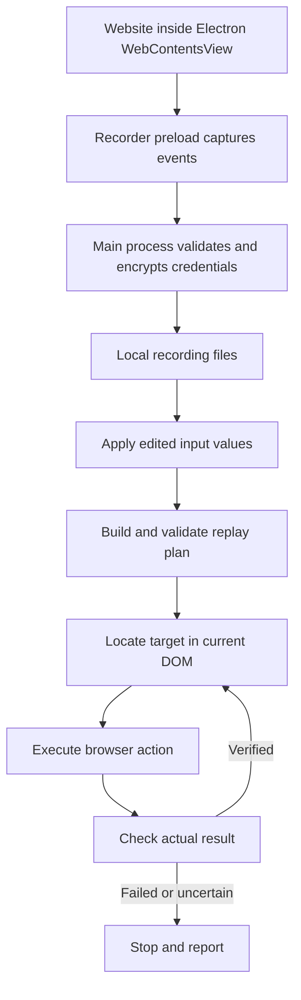

# Ghost: how recording, saving, and replay currently work

> Replay execution, background clicks, focus verification and checkpoint behavior have since changed. See [Replay resilience implementation](replay-resilience.md) for the current behavior. The capture/encryption overview below remains useful.

This describes the code as implemented on 2026-10-13. It separates working behavior from limitations and proposed improvements. It is not a claim that Ghost can replay every website interaction.

## 1. What the implementation actually does

Ghost records browser events, converts them into a smaller execution plan, and executes that plan against the live website. It checks an observable result after each supported action.

It does **not** play back a video, restore the website to a snapshot, or reproduce every original mouse movement. It does not use GPT or Screenpipe to decide what to do during replay.



There are three different things to keep separate:

| Thing | Meaning |
| --- | --- |
| Raw recording | Captured events, including noise, intermediate inputs, and unsupported events. |
| Replay plan | Actions remaining after validation and consolidation. |
| Replay result | What actually happened when those actions ran. A clean plan does not guarantee a successful run. |

## 2. Browser and session lifecycle

Opening the Record Step route calls `teaching:open` through the preload IPC bridge. The main process creates a `WebContentsView`, a `RecordingStore`, and a `FrameBridge`.

The website uses Electron's persistent partition `persist:ghost-teaching-browser`. Cookies and website storage can therefore survive between recordings. Replay does not reset the website database or clear authentication automatically.

The React renderer supplies viewport bounds. The native browser view is hidden while Ghost dialogs are open, and replay waits for a visible view. This matters because the website is a native view, not a React iframe.

Opening another teaching session creates another recording ID. The current replay IPC operates on the active session. **Files surviving an app restart does not mean the UI can reopen and replay any historical recording:** a general recording-library/import/rehydration flow is not implemented in this path.

## 3. What gets captured

[`recorder.ts`](../src/preload/recorder.ts) runs in the website's isolated, sandboxed preload. It listens for trusted user events:

- Click, double-click, context menu, pointer down/up, and drag movement.
- Input/change events, including text, checkbox state, and selected option values.
- Supported keyboard events, including Tab, Enter, arrows, and some shortcuts.
- Scroll positions, coalesced over approximately 150 ms.
- Form submission and observed changes following actions.

Navigation and downloads are captured in the main process.

A recorded event has this envelope:

```json
{
  "sequence": 32,
  "timestamp": "illustrative timestamp",
  "elapsedMs": 4200,
  "type": "input",
  "url": "http://127.0.0.1:3100/login",
  "data": {
    "target": {
      "selector": "#login-password",
      "tag": "input",
      "testId": "login-password",
      "inputType": "password",
      "label": "Password",
      "credential": true,
      "redacted": true
    },
    "value": "[ENCRYPTED]",
    "encryptedValue": {
      "version": 1,
      "iv": "base64 nonce",
      "tag": "base64 authentication tag",
      "data": "base64 ciphertext"
    }
  }
}
```

The values above illustrate the format; they are not an actual credential record.

Target descriptions can include IDs, test IDs, role, accessible name, label, placeholder, name, text, selected attributes, CSS path, surrounding container context, and frame information. Pointer events also include original coordinates, button/modifier state, and viewport dimensions.

**Coordinates are saved, but normal replay does not blindly click those old coordinates.** It resolves a live element and clicks its current center.

Text input is saved as the field's current value, often once per character. Replay usually consolidates consecutive input events to the latest value for that field. This is not a key-by-key reproduction of typing.

## 4. Where data is saved

[`recordingStore.ts`](../src/main/recordingStore.ts) writes under Electron's user-data directory. On this laptop, the observed location is:

```text
~/.config/ghost-desktop/recordings/
├── .secrets/
│   └── recording-key
└── <recording UUID>/
    ├── session.json
    ├── events.jsonl
    ├── inputs.json          # created when inputs are edited/saved
    ├── finished.json        # written on stop
    ├── last-replay.json     # replay status/results
    └── downloads/
        └── <UUID>-<filename>
```

| File | Contents |
| --- | --- |
| `session.json` | Schema version 3, workflow/node IDs, start time, environment, and capture limitations. |
| `events.jsonl` | One serialized event per line, appended in order. |
| `inputs.json` | Input overrides keyed by recorded sequence number. Secret replacements are ciphertext. |
| `finished.json` | Stop time and event count. |
| `last-replay.json` | Replay states, action results, and errors. This can also contain an intermediate approval status. |
| `downloads/` | Actual files downloaded during capture or replay. |

A promise queue serializes event writes. Stop flushes browser-frame capture before stopping the store and waiting for pending writes. Pending downloads must finish before pause/stop.

These recording artifacts are **local files**, not PostgreSQL records. The backend's workflow records and the local browser recordings are separate pieces of the application.

Export combines session metadata, raw events, and input overrides into JSON. It does not bundle the encryption key or downloaded file contents.

## 5. Passwords and encrypted inputs

[`recordingSecrets.ts`](../src/main/recordingSecrets.ts) uses AES-256-GCM:

1. Generate a random 32-byte local key if one does not exist.
2. Generate a fresh 12-byte nonce for each encryption.
3. Authenticate the recording ID plus recorded URL as additional data.
4. Save ciphertext, nonce, and authentication tag.
5. Decrypt just before replay inserts that input.

The key is a local file with mode `0600`; its directory uses `0700`. **This MVP does not use the system keyring for normal recorded passwords.** Someone who can read both the key and recordings can decrypt the values. Losing the key makes existing encrypted values unusable. Changing the recording ID or URL invalidates the authenticated ciphertext.

The recorder temporarily holds the actual value in memory and sends it through internal IPC as `secretValue`. The main process encrypts it before appending the event or publishing it to Ghost's React UI. During replay the plaintext temporarily exists in memory and is passed to Chromium's input command. Encryption does not eliminate those necessary in-memory copies.

Credential detection currently recognizes password inputs and some OTP/passcode/PIN attributes. Other sensitive fields remain redacted. This detection is heuristic: password reveal controls and unconventional markup are areas needing dedicated coverage. An expired one-time code cannot be made valid by decrypting it.

Credential flushing also checks input values before subsequent events/stop to catch some autofill paths that do not produce normal input events. This is not a guarantee for every password manager or shadow-DOM widget.

### What the input editor does

The preview receives a blank value plus `secret: true` and `saved: true` for an encrypted input. The UI displays **Saved encrypted**, not the decrypted password.

- Entering a replacement encrypts it in the main process and saves it in `inputs.json`.
- Leaving the replacement blank preserves the existing encrypted value.
- Blank replacement does not currently mean “set the password to empty.”
- Ordinary inputs remain plaintext in the recording/overrides.
- Saving inputs can fix input values; it cannot implement an unsupported browser action.

An older separate `LoginVault` / `savedLogin` implementation still exists for compatibility. Its UI was removed. The normal recorded-password path uses `RecordingSecrets`; recordings with encrypted inputs bypass that older login prerequisite.

## 6. How the replay plan is built

The path is:

```text
replay:preview or replay:start
  → read events and inputs.json
  → prepareReplay(events, inputs)
  → applyInputs(events, inputs)
  → buildReplayPlan(updated events)
```

Overrides are applied to the complete log before planning. The plan is built once so unsupported-event blockers are not accidentally lost by rebuilding from an already filtered list.

Current normalization rules include:

| Captured behavior | Planned behavior |
| --- | --- |
| Consecutive input/change events for the same field | Keep the final captured value. |
| Checkbox click followed by captured checked state | Use the final state instead of toggling twice. |
| Native dropdown navigation keys followed by a selection | Use the saved selected option values. |
| Dropdown context menu followed by a matching selection, with no recorded outcome for the menu | Consolidate the gesture into the selection. |
| Click followed by its causally linked form submission | Keep the triggering action, avoiding duplicate submission. |
| Certain unnamed layout-container clicks without recorded outcomes or causal actions | Omit from execution; retain in raw data and add a preview note. |
| Completed download tied to an action | Attach an expected download to that action. |
| Pointer down/up and capture metadata | Retain raw data, but do not execute separately. |

**The background-click rule is a heuristic.** No captured effect is not proof that a click had no effect. A custom handler on a plain `div` could matter without producing one of our observed changes. This is a tradeoff introduced to make ordinary demo recordings usable, and a strong candidate for redesign.

Unsupported events still create blockers. For example, consolidating one native-dropdown context-menu gesture does not implement arbitrary website or operating-system context menus. Double-clicks, dragging, popups, ambiguous targets, missing credentials, and some shortcuts can still stop a workflow.

## 7. How a target is found at replay time

[`pageOperation.ts`](../src/shared/pageOperation.ts) inspects the live DOM. Its locator order includes:

1. Test ID.
2. Stable ID.
3. Role plus accessible name/label.
4. Label, placeholder, name, or text.
5. Eligible recorded CSS selector as a fallback, including structural paths for unnamed targets without an ID.

Candidates are checked against tag, role, accessible name, input type, and captured surrounding context. Multiple compatible candidates at a rank cause an ambiguity error. Missing candidates can be retried until the timeout.

The engine also checks visibility, enabled state, and whether another element covers the intended click location. FrameBridge translates coordinates for supported nested frames.

Limitations: generated IDs, changing headings/counts in surrounding context, changed input types, CSS path changes, and duplicate names can still break matching. The resolver does not currently ask AI to choose an alternative.

## 8. How actions are executed and verified

[`replayRecording.ts`](../src/main/replayRecording.ts) attaches to Chromium through CDP, focuses the browser, navigates to the recorded start URL, and executes the plan sequentially.

| Action | Execution | Verification |
| --- | --- | --- |
| Navigation | Load URL or wait for the action's navigation. | Recorded destination reached. |
| Text/password | Resolve field, focus/select existing text, decrypt if needed, use `Input.insertText`; Backspace for empty text. | Live field/editor value matches. |
| Checkbox/radio | Click only when state differs. | Checked state matches. |
| Native select | Set option selection through page code and dispatch input/change. | Selected values match. |
| Click | Send native mouse events at the live element center. | Focus, navigation, recorded page evidence, or download completion, depending on the action. |
| Tab | Send native keyboard events. | Source field no longer has focus. This does not verify the exact destination field. |
| Scroll | Scroll the resolved element. | Scroll offsets match within tolerance. |
| Download | Trigger the recorded action and observe Electron download events. | Completion, expected filename/MIME type, and on-disk byte count. |

The generic download verifier does not validate CSV business contents. Our Next.js test separately checks those contents.

Waits poll page state with bounded timeouts rather than sleeping for the original recorded timing. Typical condition timeout is 10 seconds, page loading 15 seconds, and download completion 60 seconds. Original event timing is retained for inspection, not replay scheduling.

The UI's **Start test** authorizes the recording's actions for that run. The IPC also supports the older per-action approval path. Cancellation aborts the run, but cannot undo an action already dispatched.

## 9. What “verification” currently means

During capture, the recorder snapshots a limited set of status/alert/dialog elements and expanded/pressed attributes. It compares these after actions and records changes as `action-outcome` evidence. Navigation and download events provide additional signals.

This is not a complete DOM snapshot or an understanding of the user's business goal. It can miss an important change or capture an unrelated one. Multiple observations for one action are reduced to the latest entry by the planner's map.

Statuses include pending, running, verified, failed, skipped, unknown, and needs-user-approval. A failure before dispatch is different from an uncertain outcome after dispatch. The latter becomes `unknown`, and execution stops without automatically repeating the action.

Recent example: a password appeared not to replay, but encrypted password events existed. Execution stopped earlier at Tab because Tab had no verification branch. Fixing password storage again would not have fixed that failure.

## 10. What has actually been tested

- Core tests: planning, blocker retention, input overrides, encrypted values, tamper/context rejection, dropdown normalization, and background-click rules.
- Real Electron tests against the Next.js app: login, native status selection, export, and downloaded CSV contents.
- Finance and Users each passed 20 consecutive runs with the earlier login helper.
- After reproducing the Tab failure, the test was changed to mouse clicks and character-by-character key events, Tab, and repeated background clicks. Finance passed 20 runs with that revised path.

These were automated native browser input tests, not a claim that a human manually performed all twenty runs. They do not establish reliability for arbitrary sites, MFA, native menu commands, every keyboard editing pattern, or every dashboard mutation.

Run from the repository root with the Next.js app already serving port 3100:

```sh
npm run build
npm test
node scripts/check-next-replay.mjs
GHOST_DEMO_PAGE=users node scripts/check-next-replay.mjs
```

## 11. Where a better design would help

The recurring problem is the gap between **captured events**, **supported execution**, and **available evidence**. Recording more events alone does not close it.

Possible changes to evaluate, not features already implemented:

- Define a shared action model for capture, execution, and verification so unsupported behavior is apparent during recording.
- Record explicit field-focus transitions and meaningful before/after states instead of inferring them from generic events.
- Store field edits as complete operations while retaining raw events for debugging.
- Give background/optional actions an explicit classification rather than inferring “no effect” from missing evidence.
- Add a historical recording loader, node-to-recording association, and replay restoration across app restarts.
- Make verification configurable: field value, URL, visible confirmation, table contents, or exported data.
- Add bounded AI recovery only after browser tools reliably execute and report results. Keep credentials local and give the model references instead of plaintext.

For reviewing a failure, the useful questions are: Was the input captured? Was it persisted? Did it survive planning? Did replay reach it? Did execution occur? Which verification condition then failed?

## 12. Source map

| File | Responsibility |
| --- | --- |
| [RecordStep.tsx](../src/renderer/src/pages/RecordStep.tsx) | Recording UI, preview, saved-input editor, run authorization. |
| [preload/index.ts](../src/preload/index.ts) | Renderer-to-main IPC methods. |
| [preload/recorder.ts](../src/preload/recorder.ts) | Website event capture, credential flushing, limited outcome observation. |
| [teachingBrowser.ts](../src/main/teachingBrowser.ts) | Native browser lifecycle, IPC, navigation, download capture, replay launch. |
| [recordingStore.ts](../src/main/recordingStore.ts) | Ordered persistence, encryption before publication, export. |
| [recordingSecrets.ts](../src/main/recordingSecrets.ts) | Local key and AES-GCM operations. |
| [replaySettings.ts](../src/main/replaySettings.ts) | Editable inputs and override application. |
| [prepareReplay.ts](../src/main/prepareReplay.ts) | Shared override → planning entry point. |
| [replayPlan.ts](../src/main/replayPlan.ts) | Consolidation, omission rules, blockers, expected evidence. |
| [replayRecording.ts](../src/main/replayRecording.ts) | Sequential execution, waits, verification, cancellation. |
| [pageOperation.ts](../src/shared/pageOperation.ts) | Target description, resolution, DOM operations, evidence checking. |
| [frameBridge.ts](../src/main/frameBridge.ts) | Frame communication and coordinate translation. |
| [recording.ts](../src/shared/recording.ts) | Shared event, target, preview, and result types. |

## Saved browser steps and reusable credentials

Stopping a recording now saves a workflow/node-specific reference under `recordings/.saved-nodes/`. Opening that browser step later restores the same recording in the stopped state, including its `inputs.json` overrides. The recording ID stays unchanged so encrypted passwords remain decryptable with the existing device-local key. Replay fetches the saved input values and encrypted passwords from the backend automatically; the normal test flow has no input editing form. If the backend is unavailable, it explicitly falls back to the local copy.

Choose **Record again** to replace the task deliberately. Existing files remain on disk; an empty new recording does not replace the saved reference. This association is saved on Stop, Back, or exit after flushing pending inputs. Previously recorded sessions without a saved reference are not automatically selected.

This saves reusable login inputs, not everlasting authentication. A website may still require a fresh verification code, changed password or external authentication. Input values and encrypted passwords are also saved to the backend. The decryption key remains on this computer; backend recovery requires that key. Restarting Ghost can reopen and run the saved task from its beginning; resuming an interrupted run in a different browser document is still rejected.
