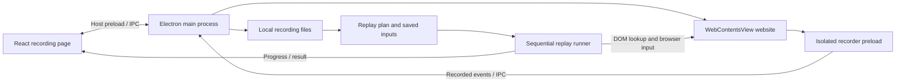

# Ghost recording and replay: implementation and reliability review

Historical review: see [the reliability changes](replay-reliability.md) for the corrected implementation.

Reviewed: 2026-10-12. This describes the current source code, including defects and unverified behavior. It is a review document; the recommendations below are not implemented by writing this document.

## Assessment

**Ghost currently has a working prototype of browser recording and sequential replay, but it is not yet a reliable general-purpose automation engine for complex websites.**

There are two separate questions:

- **Can I manually click and use the website inside Ghost?** Failure here can involve native view visibility/bounds, focus, a page overlay, a loading/crashed renderer, popup behavior, or authentication restrictions. The replay selector algorithm does not control your manual clicks.
- **Can Ghost repeat my recorded actions?** Failure here can additionally involve stale selectors, changed application state, missing elements, asynchronous rendering, rich text editors, and incomplete replay support.

We have not captured enough evidence from your exact Slack failure to blame Slack protection. Several limitations in our own implementation are sufficient to explain intermittent automation failures. Google login is a separate case: Google's OAuth policy prohibits directing authorization requests to embedded user agents controlled by the developer. Opening a popup inside Electron preserves browser behavior but does not turn it into an approved external-browser OAuth flow. [Google OAuth policy](https://developers.google.com/identity/protocols/oauth2/policies)

## Architecture



The website is a native Electron `WebContentsView`, not an iframe in the React page. The host app and the website have separate preload code. The website uses the persistent `persist:ghost-teaching-browser` session, so login and consent state may differ between recording and replay.

React measures the viewport and sends bounds to the main process. Resize, scrolling, visibility, and dialog changes update the native view. Open host dialogs hide the website so it cannot cover the dialog. This coordination is another area to investigate if manual clicks stop working after closing a modal.

This recording path does not use Screenpipe to execute actions, an AI agent to interpret the screen, or a vision model to rediscover buttons.

## Files and functions

Paths below are relative links to the implementation.

| File | Functions / handlers | Responsibility |
| --- | --- | --- |
| [RecordStep.tsx](../src/renderer/src/pages/RecordStep.tsx) | `bounds`, `go`, `action`, `controlRecording`, `previewReplay`, `startReplay`, `cancelReplay`, `exportSession`, `exitRecording` | Recording UI, browser controls, event inspection, input editing, test confirmation and progress |
| [Host preload](../src/preload/index.ts) | `window.ghost.browser.*` | Narrow IPC bridge between React and main; event subscription/unsubscription |
| [teachingBrowser.ts](../src/main/teachingBrowser.ts) | `registerTeachingBrowser`, `owner`, `get`, `guest`, `position`, `load`, `record`, `dispose`, internal `replayPlan` | Owns native views, sender checks, browser session, recording/replay IPC, popup lifecycle |
| [Recorder preload](../src/preload/recorder.ts) | `masked`, `selector`, `target`, `eventTarget`, `point`, `input`, `emit`, `flush` | Observes trusted DOM events and constructs recording metadata |
| [recordingStore.ts](../src/main/recordingStore.ts) | `RecordingStore.append`, `status`, `flush`, `stop`, `exportJSON` | Queued local persistence and export |
| [replayPlan.ts](../src/main/replayPlan.ts) | `buildReplayPlan` | Filters events, coalesces inputs, removes duplicate actions, identifies blockers and optional consent clicks |
| [replaySettings.ts](../src/main/replaySettings.ts) | `recordingInputs`, `applyInputs` | Lists editable non-sensitive text inputs and applies sequence-based overrides |
| [replayRecording.ts](../src/main/replayRecording.ts) | `replayRecording`, `performOnPage`, `inputModifiers`; internal `locate`, `idle`, `deadline`, `wait`, `check`, `status` | Target lookup, execution, timeouts, progress and cancellation |
| [browserAddress.ts](../src/main/browserAddress.ts) | `browserURL`, `resolveBrowserAddress` | Validates HTTP(S) destinations; converts address-bar searches to Google searches |
| [Main entry](../src/main/index.ts) | `createWindow`, `logFailure` | App window, Linux software rendering default, process diagnostics and native crash dialog |
| [Shared types](../src/shared/recording.ts) and [browser bridge types](../src/shared/browser.ts) | `RecordedEvent`, `RecordingStatus`, `ReplayPreview`, `ReplayStatus`, `TeachingBrowser` | Payload contracts |

Main IPC groups:

- `teaching:open/navigate/action/bounds/close`: browser lifecycle and navigation.
- `recorder:ready/enabled/event/flush/flushed`: capture coordination with the website preload.
- `recording:control/status/export`: pause, resume, stop, status and JSON export.
- `replay:preview/inputs/start/cancel`: review, save edited inputs, execute and abort.
- `teaching:state`, `recording:event`, `replay:status`: updates sent to React.

## What gets recorded

The recorder observes clicks, double-clicks, context menus, pointer down/up, sampled drag movements, input/change events, selected navigation keys, scrolling, form submission and page readiness. Main-process navigation listeners add full-page and same-document navigation events.

Events include sequence, timestamp, elapsed time, URL and action data. DOM action metadata includes:

- CSS selector, tag, ID, name, role, test ID, label, text and placeholder.
- Element bounds; pointer coordinates relative to the viewport, page, screen and element.
- Normalized position inside the element, keyboard modifiers, viewport size and device scale.
- Page scroll offset/title, input value, checkbox state or selected option values as applicable.
- A masking flag and limited open-shadow-root context.

Capture is main-frame only. There is no frame-aware capture/replay for iframe contents, including same-origin frames. Closed shadow roots are unsupported; deeply nested open roots are not robustly addressed. Pointer movement without a pressed button is not recorded, so hover-only menu activation is not reproduced.

Values are capped at 10,000 characters; truncation is marked. Scroll capture is debounced at 150 ms. Only the latest 300 events appear in the UI, but the recorded file/export is not limited to 300 events.

Sensitive-field masking uses attribute patterns such as password, token and payment-field names. This is heuristic masking, not a guarantee that all sensitive data is removed from URLs, text or mislabeled fields.

## Storage and saved inputs

Under `<Electron userData>/recordings/<recording-id>/`:

| File | Contents |
| --- | --- |
| `session.json` | Recording ID, workflow/node IDs, environment and schema metadata |
| `events.jsonl` | Original captured events, appended through a write queue |
| `finished.json` | Stop time and event count |
| `inputs.json` | User-edited text overrides: sequence, label and value |
| `last-replay.json` | Latest terminal replay status, action sequence, counts, error and finish time |

The UI Console shows the folder. Recording directories request mode `0700`; files request `0600`. These are local plaintext files, not encrypted storage or a credential vault. Chromium's persistent browser session separately maintains website state; session cookies are not included in the recording export.

**Save inputs** stores overrides for this recording; **Start test** also saves edits. Original event data remains unchanged. Overrides use event sequence numbers, not reusable semantic variables such as `customer_email`. Checkbox/select changes are replayed from the recording but are excluded from this text-input editor. Multiple edits to one field can remain as separate entries. There is no global input library, secret manager, saved-session import/reopen UI, or server synchronization.

The JSON export currently contains original events and metadata, **not the separate `inputs.json` overrides**. Exporting a recording therefore does not preserve the complete edited test configuration.

## How replay works

1. Require the current recording to be stopped; read its events and saved overrides.
2. Build a sequence of supported actions. Coalesce adjacent input events on the same selector/URL. Attempt to avoid duplicate double-clicks and form submissions.
3. Display the preview and request confirmation because replay can perform real website actions.
4. Focus the host/browser, then load the first recorded navigation URL (or first action URL).
5. For each DOM action, check website origin and find exactly one matching selector in the document or recorded open shadow root.
6. Check selected identity attributes, visibility, disabled state and the element at the intended click point. Scroll/focus the target.
7. Recalculate the click point from the element's current bounds and saved relative offset; send browser mouse or key input. Inputs and scrolls use separate DOM operations.
8. Wait between actions, publish progress, and finish, fail or cancel.

There is some adaptation to layout changes: positions are recalculated and targets are retried. But there is **one selector, not a semantic locator system**. The engine does not search by accessible name, compare candidate scores, inspect screenshots or re-plan when the page changes.

Timing is basic: approximately five seconds of target polling plus script execution time, up to ten seconds waiting for loading, a fifteen-second navigation deadline, about four seconds for an expected action-driven URL, and a fixed 250 ms delay between steps. Original user timing is not replayed. `isLoading()` becoming false does not establish that an application's asynchronous UI is ready.

Mouse/selected key actions use `sendInputEvent`; Electron requires the containing window to be focused. The runner requests focus initially but does not verify it before every input. [Electron webContents documentation](https://www.electronjs.org/docs/latest/api/web-contents/)

Text inputs use native property setters plus dispatched `input`/`change` events. Contenteditable elements are assigned `textContent`. These are not a full typing sequence with selection, composition and editor transactions. Script-dispatched events have `isTrusted=false`, which a website can distinguish. This is a possible compatibility issue, not evidence that Slack is rejecting our events. [MDN isTrusted](https://developer.mozilla.org/en-US/docs/Web/API/Event/isTrusted)

## Why dynamic applications can fail

| Mechanism | Current limitation | Possible symptom |
| --- | --- | --- |
| Changing DOM | Generated IDs or `nth-of-type` paths can change | Missing selector, or selector resolves to a different repeated row |
| Virtualized lists | Offscreen items may not exist in the DOM | Recorded message cannot be found; scrolling an existing target cannot create it |
| Rich editors | Replacing `textContent` can bypass editor state | Text appears but disappears, fails to submit or is not recognized |
| Async updates | No application-specific readiness conditions | Click happens before a menu, result or dialog is ready |
| Hover menus | Hover-only transitions are not captured | Button never becomes visible |
| Focus / native view | Native input and modal/view coordination depend on focus/visibility | Manual or replay clicks do nothing |
| Session changes | Consent/login state persists; replay does not restore initial state | Already-dismissed dialog or different landing page |
| Frames and popups | No multi-frame/window action execution | Embedded control cannot be recorded or replayed |
| URL matching | Expected navigation uses exact URL strings | Redirect/query changes produce a failure |
| Website authentication | Embedded-browser OAuth can be restricted | Login refusal even when popup creation works |
| Outcome verification | No business-result assertion | Test reports completed even though the intended result did not happen |

The selector identity checks compare tag/ID/test ID, not the general label/text or business identity of the target. A reused row selector can therefore match the wrong row. Failing on missing targets is useful, but it does not guarantee every matched target is correct.

## Cookie handling and login scope

Specific English cookie labels are marked optional. Generic “Accept all” or “Reject all” additionally requires recorded consent context. An optional target absent or hidden at lookup time is skipped. This is a small heuristic, not a general consent manager: translations, changed labels, nested targets, delayed banners, or a different selector can still fail. A banner that has not appeared yet may also be mistaken for an already-dismissed banner. Skipped consent actions count toward completed actions; there is no durable per-step skip trace.

Popups now use child windows with the same browser session and preserve the opener relationship. A local fixture verified opening and message return. **Actual Google/Slack login success has not been verified.** Actions inside those popups are not replayed. Finishing login before recording helps only where the site supports login in this browser; it is not a workaround for a provider's embedded-browser policy.

## Concrete issues found in this review

### 1. Unsupported-action blockers can be lost — confirmed

The internal `replayPlan()` in `teachingBrowser.ts` calls:

```ts
const plan = buildReplayPlan(events)
return buildReplayPlan(applyInputs(plan.steps, inputs))
```

The first pass records blockers for `popup-open` and `drag-move`, but removes those events from `steps`. The second pass cannot see them, so their blockers disappear when there are other supported actions. A direct reproduction with a popup event followed by a click produced a popup blocker on pass one and no blockers on pass two.

This contradicts the earlier claim that all such recordings are blocked before replay. Preserve the original validation result and apply overrides without rebuilding from an already-filtered event list. Add a test through the actual main-process planning path.

### 2. “Completed” is not verified success

After sending an action, the runner increments progress without asserting its intended effect. It does not check that text remains in the editor, the expected dialog appears, or a submission succeeded. Do not treat completion as a verified workflow result.

### 3. Capture and input flushing need tightening

Text input is emitted immediately; the `pending` map/flush scaffolding does not currently provide meaningful input debounce. The last debounced scroll is not flushed by `flush()`, so stopping immediately after scrolling can lose it. Pause/stop waits at most 500 ms for a flush acknowledgement and then continues.

### 4. Automatic retries must respect side effects

There is target polling but no transaction/duplicate-action tracking. Retrying a whole run can submit or send something again. The submit deduplication rule is a timing heuristic, not a verified relationship between a button and its form.

### 5. No reproducible initial-state or application-state contract

Starting URL and shared browser session are the only broad state assumptions. There are no explicit prerequisites such as workspace selected, user signed in, channel open, or no modal covering the page.

## Graphics status and test evidence

Linux now defaults to software rendering. Process exits are logged to `<Electron userData>/logs/process-errors.jsonl`; a host renderer crash offers a native recovery dialog and disposes the teaching view/replay. This is a mitigation for graphics instability, not a confirmed diagnosis of your black-screen incident. GPU buffer-limit warnings alone do not prove causation.

Earlier local fixtures passed action capture, password masking, pause/stop, persistence, replay, edited input reuse, missing cookie target handling, missing required target failure, cancellation, and popup opener/message behavior. These tests do not establish reliability on Slack.

After the software-rendering change, build/startup passed, but replay integration attempts failed or were inconclusive: timeouts, a missing target, and a recording with no replayable interactions. The test then failed when it assumed an input editor existed. Those failures remain unresolved; they must not be described as a fully passing current end-to-end suite. Native crash recovery was not deliberately crash-tested.

Relevant checks are in [scripts](../scripts): `check-action-recording.mjs`, `check-recording-replay.mjs`, `check-provider-popup.mjs`, `check-replay-plan.mjs`, `check-browser-address.mjs`, and `check-teaching-browser.mjs`.

## Recommended next work

1. Preserve planning blockers and add main-process integration coverage; fix export to include input overrides.
2. Diagnose manual clicking separately: log focus, view bounds/visibility, capture enabled state and event receipt. Reproduce one failing interaction with its exact URL and selector, without collecting secrets.
3. Replace single selectors with ranked locators using stable attributes, accessible role/name, context and uniqueness. Explicitly handle virtualized content and frames.
4. Add readiness conditions and post-action assertions. Stop when state is uncertain; do not blindly repeat actions with side effects.
5. Use editor-aware/native text entry with value verification; cover controlled inputs, contenteditable editors, selection and IME behavior in fixtures.
6. Model optional setup steps and prerequisites explicitly instead of relying only on cookie-label heuristics.
7. Add named input variables, recording reopen/import and separate secure secret handling where needed.
8. For authentication, use provider-supported external-browser authorization where applicable; merely opening an external browser will not automatically transfer a third-party site's login into Electron. For repeatable business operations, evaluate official service APIs with proper authorization instead of UI replay.

Acceptance should include repeated runs across changed layouts, delayed UI, existing consent, focus changes, empty recordings, repeated rows, controlled/rich inputs and navigation redirects. Verify the actual result, not just the count of actions sent.
